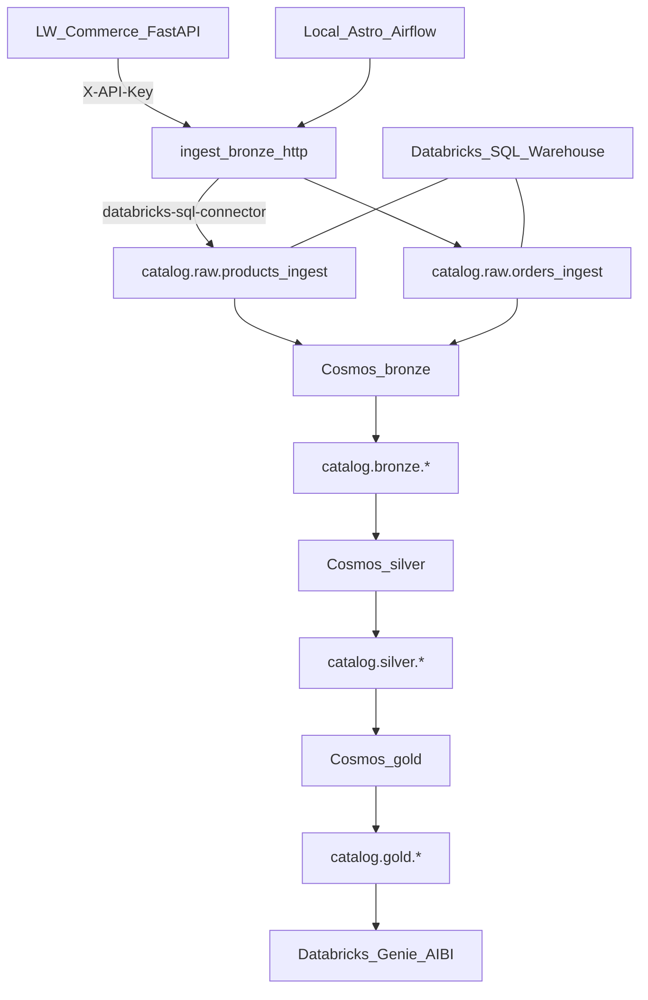
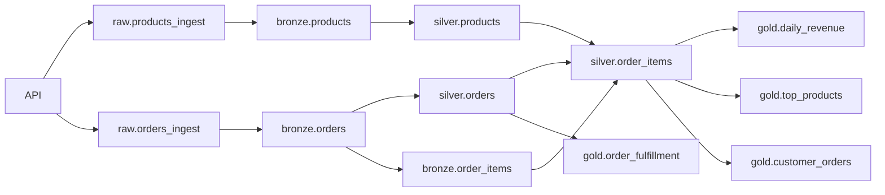

# Le Wagon · LW Commerce Medallion Demo

**Astro CLI + Astronomer Cosmos + dbt-databricks + Databricks SQL Warehouse**

Teaching demo for Le Wagon Data Engineering: an invented **LW Commerce** FastAPI feeds Delta tables in Unity Catalog through a medallion lakehouse orchestrated by Airflow (Cosmos).

Unlike the [travel-hacking hackathon](https://github.com/aoelvp94/databricks-free-edition-hackaton) (synthetic rows generated inside notebooks) and unlike a pure DLT pipeline bundle, this project:

1. **Ingests over HTTP** from a local FastAPI (`api/`) into `catalog.raw.*` via `databricks-sql-connector`
2. **Transforms with dbt** (bronze → silver → gold) run by **Cosmos `DbtTaskGroup`s**
3. Surfaces **≥4 gold KPI tables** ready for Databricks **Genie** / AI/BI dashboards

Mold: Aldo's `brewery-cosmos-demo` (same Astro root, Cosmos profile mapping, sequential medallion groups) — adapted from Open Brewery DB → LW Commerce orders/products.

## Architecture



| Layer | Responsibility | Written by |
|-------|----------------|------------|
| `raw` | Append-only API landing (`payload` STRING JSON) | Airflow `ingest_bronze_http` |
| `bronze` | Flatten + dedupe products/orders + explode items | dbt |
| `silver` | Typed commerce entities | dbt |
| `gold` | KPIs for Genie / dashboards | dbt |

Airflow **metadata** Postgres stays inside Astro. Only the **analytics** warehouse is Databricks.

### Medallion tables (Unity Catalog)

Layer = schema. Table names have **no** `bronze_` / `silver_` / `gold_` prefix.

| Table | Grain / meaning |
|-------|-----------------|
| `bronze.products` / `orders` / `order_items` | Flattened + deduped entities from raw ingest |
| `silver.products` / `orders` / `order_items` | Typed commerce entities |
| `gold.daily_revenue` | Revenue, orders, customers, AOV by `order_date` × `country` |
| `gold.top_products` | Units + revenue ranking per product |
| `gold.order_fulfillment` | Status funnel (created/paid/shipped/delivered/cancelled) by country |
| `gold.customer_orders` | Per-customer LTV proxy, AOV, primary country |

> dbt model *IDs* for bronze/silver stay `bronze_products` / `silver_products` (must be unique in one project); `alias:` maps them to the unprefixed UC table names. Gold model files are `daily_revenue.sql`, etc.

See [docs/GENIE_DEMO.md](docs/GENIE_DEMO.md) for classroom NL questions (EN/ES) and AI/BI tile ideas.

## Student guide, tests & lineage

- **[docs/STUDENT_GUIDE.md](docs/STUDENT_GUIDE.md)** — what each step does (API → ingest → raw → bronze → silver → gold → Genie) and why Astro / Cosmos / Databricks SQL / credentials are set up this way.
- **[docs/LINEAGE.md](docs/LINEAGE.md)** — full table lineage diagram, dbt tests overview, and Unity Catalog lineage.
- dbt docs UI: `just docs` → http://localhost:8081 → *View Lineage Graph* (or `dbt docs generate && dbt docs serve --port 8081` in `dags/dbt/lw_commerce`).



## Prerequisites

- [Astro CLI](https://www.astronomer.io/docs/astro/cli/install-cli) (`astro`)
- Docker running
- [just](https://github.com/casey/just) (`brew install just`)
- Databricks workspace (Free Edition OK) with a **SQL Warehouse**, UC create permissions, and a **PAT**

## Credentials

```bash
cp .env.example .env
cp airflow_settings.yaml.example airflow_settings.yaml
# fill DATABRICKS_HOST / HTTP_PATH / TOKEN in both files
# Astro does NOT expand ${ENV} in airflow_settings.yaml — paste values
```

| Variable | Where |
|----------|-------|
| `DATABRICKS_HOST` | Workspace URL |
| `DATABRICKS_HTTP_PATH` | SQL Warehouse → Connection details |
| `DATABRICKS_TOKEN` | Settings → Developer → Access tokens |
| `DATABRICKS_CATALOG` | Usually `workspace` on Free Edition |
| `API_BASE_URL` | Default `http://api:8000` (compose service) |
| `API_KEY` | Default `lewagon-demo` |

Never commit `.env` or a filled `airflow_settings.yaml`.

## Quick start

```bash
cd lewagon-databricks-medallion-demo
# credentials configured as above
just demo          # start Astro (+ API), ping warehouse, trigger DAG
just ui            # Airflow http://localhost:8080  (admin/admin)
just smoke         # hit LW Commerce API
just kpis          # peek gold tables after success
just dashboard     # gold KPIs page inside Airflow (plugin)
```

Or step by step:

```bash
just start         # first build takes a few minutes (dbt_venv)
just ping
just trigger       # run lw_commerce_lakehouse
just counts
just dbt-run --select path:models/gold
```

| | |
|---|---|
| Airflow UI | http://localhost:8080 (override with `AIRFLOW_URL` if 8080 is taken) |
| LW Commerce API | http://localhost:8000/docs |
| Login | `admin` / `admin` |
| DAG | `lw_commerce_lakehouse` |

If the API container is unreachable, ingest **falls back** to `include/data/sample_*.json` (same seed as the API).

## Airflow plugin · LW Commerce KPIs (gold dashboard)

Classroom point: Airflow's `plugins/` folder can **host custom web pages inside the Airflow UI**.
This one reads the four gold tables live through Databricks SQL (no mock data).

| | |
|---|---|
| Menu | Top nav → **LW Commerce KPIs** (bar-chart icon) |
| In-UI page (iframe) | http://localhost:8080/plugin/lw-commerce-kpis |
| Raw page | http://localhost:8080/lw-commerce/ (`?refresh=1` bypasses the 60 s cache) |
| JSON | http://localhost:8080/lw-commerce/api/kpis |
| Code | `plugins/lw_commerce_dashboard_plugin.py` + `plugins/lw_commerce_dashboard/` |

After `just demo` (and once the `gold` task group is green) run `just dashboard` or click the menu entry.

- **Airflow 3 style** (Runtime 3.3 = Airflow 3.3): `fastapi_apps` mounts a FastAPI app on the API server at `/lw-commerce`, `external_views` adds the nav entry and embeds it as an iframe. This replaces Airflow 2's Flask-AppBuilder `appbuilder_views` / `appbuilder_menu_items` (only available in Airflow 3 via the FAB provider compatibility layer).
- **Same connection path as the DAG**: `include/databricks_client.py` → Airflow connection `databricks_sql`, falling back to `DATABRICKS_*` env vars (the `api-server` gets them from `docker-compose.override.yml`).
- **Auth**: Airflow does not authenticate plugin apps, so the app depends on `get_user` — only logged-in Airflow users (UI cookie or Bearer token) can open it.
- **Graceful states**: missing creds / unreachable warehouse → red banner with fix steps; gold not built → yellow banner, per-table errors (`TABLE_OR_VIEW_NOT_FOUND`).
- The SQL behind each tile is shown at the bottom of the page (*SQL behind this page*).

| Tile | Gold table | Query (catalog default `workspace`) |
|------|-----------|-------|
| Revenue / Orders / AOV / Countries | `gold.daily_revenue` | `SUM(revenue_eur)`, `SUM(orders)`, revenue/orders, `COUNT(DISTINCT country)`, `MAX(gold_loaded_at)` |
| Customers (repeat %, avg revenue) | `gold.customer_orders` | `COUNT(*)`, `AVG(revenue_eur)`, share with `orders > 1` |
| Daily revenue (bars, last 14 days) | `gold.daily_revenue` | `GROUP BY order_date ORDER BY order_date DESC LIMIT 14` |
| Revenue by country | `gold.daily_revenue` | `GROUP BY country ORDER BY revenue_eur DESC` |
| Top products | `gold.top_products` | `ORDER BY revenue_eur DESC LIMIT 10` |
| Fulfillment funnel | `gold.order_fulfillment` | `SUM(order_count) GROUP BY status` + % of total |
| Top customers | `gold.customer_orders` | `ORDER BY revenue_eur DESC LIMIT 10` |

Plugin code changes need an API-server restart: `just restart`. Debug with `astro dev run plugins`.

## Project layout

```text
lewagon-databricks-medallion-demo/     # Astro project root
├── Dockerfile                         # Runtime 3.3-2 + dbt-databricks venv
├── docker-compose.override.yml        # DATABRICKS_* + api service + UI :8090
├── plugins/                           # Airflow UI plugin: LW Commerce KPIs (gold dashboard)
├── requirements.txt                   # Cosmos + Databricks connector
├── .env.example
├── airflow_settings.yaml.example
├── justfile
├── api/                               # FastAPI LW Commerce (invented)
├── include/
│   ├── lw_commerce_ingest.py          # HTTP → raw.* Delta landing
│   ├── databricks_client.py
│   ├── warehouse_cli.py
│   ├── data/sample_*.json             # offline fixtures
│   └── sql/init_warehouse.sql
├── dags/
│   ├── lw_commerce_lakehouse_dag.py   # ingest → bronze → silver → gold
│   └── dbt/lw_commerce/               # dbt project
├── docs/GENIE_DEMO.md
├── notebooks/optional/                # legacy DLT bronze reference only
└── terraform/                         # optional UC schemas only
```

## Contrast vs previous demos

| | Hackathon (travel) | This demo |
|--|--------------------|-----------|
| Data source | Synthetic in-notebook | Invented HTTP API |
| Orchestration | Databricks jobs / DLT | Astro + Cosmos |
| Silver/gold | DLT notebooks | **dbt-databricks** |
| Classroom Genie | ad-hoc | [docs/GENIE_DEMO.md](docs/GENIE_DEMO.md) |

## ES · Nota corta

Demo de clase: API inventada (LW Commerce) → landing `raw` en Databricks → dbt (Cosmos) arma bronze/silver/gold. Levantá Astro con `just demo`, configurá host/token/http_path, y corré el DAG `lw_commerce_lakehouse`. Después usá Genie con las preguntas de `docs/GENIE_DEMO.md`.

## Branches (dbt versions)

| Branch | Notes |
|--------|-------|
| [`main`](https://github.com/aoelvp94/lewagon-databricks-medallion-demo) | Teaching demo on **dbt-databricks 1.12** (Core 1.x) |
| [`dbt-v1`](https://github.com/aoelvp94/lewagon-databricks-medallion-demo/tree/dbt-v1) | Explicit Core 1.x pin + README note |
| [`dbt-v2`](https://github.com/aoelvp94/lewagon-databricks-medallion-demo/tree/dbt-v2) | Fusion / dbt v2 install path + bench recipes; Cosmos stays on 1.12 venv |

Scale parse/compile harness: [`bench/`](bench/) (~750 synthetic models under `dags/dbt/lw_commerce_scale`). Details: [docs/DBT_V1_VS_V2.md](docs/DBT_V1_VS_V2.md).
