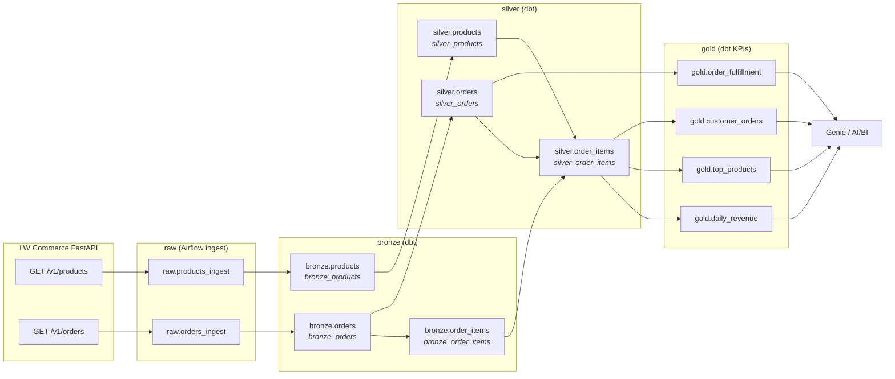

# Lineage & dbt docs

How data flows from the invented LW Commerce API to the gold KPI tables, and how to
**see** that lineage in the dbt docs UI and in Databricks Unity Catalog.

## Table-level lineage

UC schema = layer; table names have no layer prefix. dbt model IDs are shown in *italics* where they differ.



Note `bronze.order_items` is built from **bronze.orders** (it explodes the `items[]` array kept in
`items_payload`), not directly from raw.

## dbt docs UI (descriptions + interactive lineage graph)

All models, sources and columns are described in `models/**/schema.yml`; shared text lives in
`models/docs.md` as `` blocks (the project overview page is `__overview__`).

```bash
cd dags/dbt/lw_commerce
export DATABRICKS_HOST=dbc-xxxx.cloud.databricks.com   # no https://
export DATABRICKS_HTTP_PATH=/sql/1.0/warehouses/<id>
export DATABRICKS_TOKEN=...                            # never commit
export DATABRICKS_CATALOG=workspace

dbt build --profiles-dir .            # models + all tests
dbt docs generate --profiles-dir .    # writes target/manifest.json + catalog.json (queries warehouse for column types)
dbt docs serve --profiles-dir . --port 8081
# open http://localhost:8081 → bottom-right "View Lineage Graph"
```

Shortcut from the repo root: `just docs` (uses `$DBT_BIN` or `dbt` on PATH).

Tips for class:
- In the graph, type `+daily_revenue` in **--select** to show only its upstream; `bronze_orders+` for downstream.
- Use `--select tag:gold` / `tag:silver` to show one layer.
- Green nodes are sources (`raw.*`); tests appear on each model's page.

`docs serve` is a local static server. Inside Astro the scheduler container doesn't expose a port,
so run docs from a local venv (`pip install dbt-databricks==1.12.4`).

## Tests (what they guarantee)

| Layer | Tests |
|---|---|
| raw (sources) | `not_null` on ids / payload |
| bronze | `unique` + `not_null` keys; `order_items.order_id` → `bronze_orders` relationship |
| silver | `unique` keys; `accepted_values` on `status`; FK `order_items` → `orders` (error) and → `products` (warn, left join) |
| gold | `unique` grain keys (`top_products.product_id`, `customer_orders.customer_id`); `accepted_values` on funnel status |
| singular (`tests/`) | line_amount = qty × price; gold revenue reconciles with silver; funnel % sums to 100 per country; no future orders |

Run only tests: `dbt test --profiles-dir .` (or `just dbt-test`). Last run on Free Edition: **65/65 PASS** for `dbt build`.

## Databricks lineage (Unity Catalog)

Because dbt runs SQL through a UC SQL Warehouse, Databricks records **table and column lineage
automatically** — no extra config. In Catalog Explorer open e.g. `workspace.gold.daily_revenue`
→ **Lineage** tab → *See lineage graph*. You'll see `silver.order_items` upstream and, going further,
`raw.*`. This also works on **Free Edition** (UC is on by default). It's a nice contrast for students:
dbt lineage = *declared* in code (`ref`/`source`); UC lineage = *observed* from executed queries.
