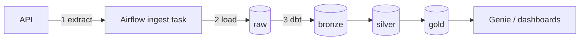

# Student guide · LW Commerce medallion lakehouse

This guide explains **what happens at each step** and **why the stack looks like this**.
Read it before running `just demo`.

## 1. The big picture

A fake shop, *LW Commerce*, exposes products and orders over an HTTP API. We want analysts (and
Databricks **Genie**) to ask questions like "revenue by country last week". To get there we:

1. **Extract** JSON from the API,
2. **Load** it untouched into the warehouse (`raw`),
3. **Transform** it in SQL with dbt through three quality layers — the **medallion** pattern:
   `bronze` (structured) → `silver` (clean) → `gold` (business KPIs).

This is **ELT**: load first, transform inside the warehouse where compute is cheap and scalable.



Full table lineage: [LINEAGE.md](LINEAGE.md).

## 2. Step by step

| # | Step | What happens | Where in the repo |
|---|------|--------------|-------------------|
| 0 | **API** | FastAPI serves `/v1/products` and paginated `/v1/orders` (key `X-API-Key`). Data is invented but realistic (statuses, multiple items per order). | `api/` |
| 1 | **Orchestrate** | Airflow DAG `lw_commerce_lakehouse` defines the order of tasks, retries and the schedule. | `dags/lw_commerce_lakehouse_dag.py` |
| 2 | **Ingest → raw** | Python task calls the API, then `INSERT`s each record as a STRING JSON `payload` + `batch_id` + `ingested_at` into `raw.products_ingest` / `raw.orders_ingest`. Append-only: we never edit raw, so we can always replay. If the API is down it uses `include/data/sample_*.json`. | `include/lw_commerce_ingest.py`, `include/sql/init_warehouse.sql` |
| 3 | **bronze** | dbt parses JSON (`get_json_object`, `from_json`), keeps only the **latest** row per key (`row_number()`), and explodes `items[]` into one row per order line. Result: one row per entity — re-running ingest doesn't duplicate. | `dags/dbt/lw_commerce/models/bronze/` |
| 4 | **silver** | Cleaning + business rules: lower-case status, `order_date`, drop non-positive prices/quantities, enrich order lines with customer/country/product. This is the "single source of truth". | `models/silver/` |
| 5 | **gold** | Aggregated KPIs shaped for questions: `daily_revenue`, `top_products`, `order_fulfillment`, `customer_orders`. Cancelled orders excluded from revenue. | `models/gold/` |
| 6 | **Tests** | Each layer has tests (unique, not_null, relationships, accepted_values + SQL checks). A failing test stops downstream tasks in Cosmos. | `schema.yml`, `tests/` |
| 7 | **Consume** | Point Genie at the `gold` schema and ask questions in English/Spanish. | [GENIE_DEMO.md](GENIE_DEMO.md) |

### Why three layers?
- **bronze** answers "what did the source say?" — structured but faithful.
- **silver** answers "what is true?" — clean, conformed, joinable.
- **gold** answers "what does the business need?" — small, fast, documented tables.
When a number looks wrong in gold you can walk back layer by layer to find where it changed.

## 3. Why this stack (setup rationale)

| Tool | Role | Why we use it here |
|------|------|--------------------|
| **Astro CLI** | Runs Airflow locally in Docker (`astro dev start`) | One command for scheduler, webserver, metadata DB; same project deploys to Astronomer cloud. No manual Airflow install. |
| **Airflow** | Orchestrator | Industry standard; shows dependencies, retries, history (grid view). |
| **Astronomer Cosmos** | Turns a dbt project into Airflow tasks | Each dbt model/test becomes a task in the graph (`DbtTaskGroup` per layer), so you see and retry per model instead of one opaque `dbt run`. |
| **dbt (dbt-databricks)** | SQL transformations | Version-controlled SQL, `ref()` builds the dependency graph automatically, tests + docs + lineage for free. |
| **Databricks SQL Warehouse** | Compute that runs the SQL | Serverless, starts in seconds, works on Free Edition; dbt and the ingest both talk to it via `databricks-sql-connector`. |
| **Unity Catalog** | Storage + governance | `catalog.schema.table` (`workspace.gold.daily_revenue`), permissions, and automatic lineage. |
| **just** | Command runner | Short memorable commands (`just demo`, `just docs`) instead of long docker/astro lines. |

Where does dbt run? Inside the Airflow worker container (a Python venv `dbt_venv`). dbt only
*compiles* SQL and sends it; the heavy lifting happens on the Databricks warehouse.

## 4. Credentials (and why they're handled this way)

| Value | What it is | Where to find it |
|-------|------------|------------------|
| `DATABRICKS_HOST` | Your workspace URL | Browser address bar |
| `DATABRICKS_HTTP_PATH` | Which SQL Warehouse to use | SQL Warehouses → your warehouse → *Connection details* |
| `DATABRICKS_TOKEN` | Personal Access Token = your password for APIs | Settings → Developer → Access tokens |
| `DATABRICKS_CATALOG` | Top-level namespace | `workspace` on Free Edition |

- They live in `.env` (read by docker compose) and `airflow_settings.yaml` (creates the Airflow
  connection `databricks_sql` that Cosmos uses). Both are **gitignored**; only `*.example` files are committed.
- Never paste a token in code, a notebook, or Slack. If it leaks: revoke it in Databricks and create a new one.
- Astro does not expand `${VAR}` inside `airflow_settings.yaml`, so you paste the values there.

## 5. Run it

```bash
cp .env.example .env && cp airflow_settings.yaml.example airflow_settings.yaml   # fill values
just demo        # Astro + API, ping warehouse, trigger DAG
just ui          # http://localhost:8080  (admin/admin) → DAG lw_commerce_lakehouse → Graph
just kpis        # peek gold
just docs        # dbt docs + lineage graph on http://localhost:8081
```

Then open Catalog Explorer → `workspace` → `bronze` / `silver` / `gold` and the **Lineage** tab.

## 6. Exercises
1. Add a gold model `category_revenue` (revenue by category × month). Add `unique` test on its grain.
2. Break something: set a product price to 0 in the API seed. Which layer drops it? Which test would catch it if it didn't?
3. Re-trigger the DAG twice. Why do bronze row counts stay the same while raw grows?
4. Compare the dbt lineage graph with the UC Lineage tab. What does each one know that the other doesn't?
